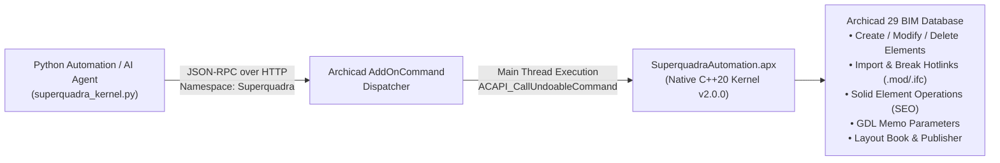

# Superquadra Archicad Kernel (`SuperquadraAutomation.apx`) — v2.0.0

[](https://graphisoft.com/downloads/archicad)
[](https://archicadapi.graphisoft.com/)
[](./python/superquadra_kernel.py)
[](https://github.com/yan-fab/superquadra-archicad-kernel/releases/tag/v2.0.0)
[](./LICENSE.md)

**Superquadra Archicad Kernel** (`SuperquadraAutomation.apx`) is a native C++ Kernel Extension (Add-On) and Python SDK for **Graphisoft Archicad 29**. It bypasses the severe limitations of Archicad's built-in Python JSON API by exposing **15 native C++ ACAPI kernel commands** directly under the `"Superquadra"` namespace via `ACAPI_AddOnAddOnCommunication_InstallAddOnCommandHandler`.

---

## Why This Kernel Exists

Archicad's standard JSON/Python API operates at a restricted high level: it **cannot** create or delete elements, modify wall/slab/window coordinates, import or break Hotlink modules (`.mod` / `.ifc`), execute Solid Element Operations (SEO boolean cuts), place Views onto Layout sheets, or edit GDL parameters (`API_ElementMemo`).

`SuperquadraAutomation.apx` bridges Python directly into the Archicad C++ database kernel (`ACAPI_CallUndoableCommand`), enabling **100% headless, end-to-end BIM automation**.



---

## Kernel v2.0.0 Capabilities (15 Registered C++ Commands)

| # | Kernel Command (`Superquadra.*`) | C++ ACAPI Kernel Primitives | Description |
| :-: | :--- | :--- | :--- |
| **1** | `Ping` | `API_AddOnCommand` | Returns kernel health, version (`2.0.0`), access level (`5`), and list of registered commands. |
| **2** | `ChangeElementsLayer` | `ACAPI_Attribute_Create`, `ACAPI_Element_Change` | Moves elements to a target layer (automatically creates the layer if missing). |
| **3** | `ManageHotlinks` | `ACAPI_Hotlink_CreateHotlinkNode`, `ACAPI_Element_Create`, `ACAPI_Hotlink_BreakHotlinkNode`, `ACAPI_Hotlink_DeleteHotlinkNode` | Full Hotlink lifecycle: `list`, `import` (`.mod`/`.pln`/`.ifc` with 3D transformation matrix), `break` into native elements, and `delete`. |
| **4** | `DeleteElements` | `ACAPI_Element_Delete` | Batch-deletes any elements by GUID in a single undoable transaction. |
| **5** | `ListLayers` | `ACAPI_Attribute_GetNum`, `ACAPI_Attribute_Get` | Lists all project layers with index, name, GUID, `locked`, and `hidden` flags. |
| **6** | `ModifyLayersState` | `ACAPI_Attribute_Modify`, `ACAPI_Attribute_Delete` | Batch lock/unlock, show/hide, or delete layers in the kernel. |
| **7** | `PublishSet` | `ACAPI_Navigator_GetNavigatorSet`, `ACAPI_ProjectOperation_Publish` | Triggers native Archicad Publisher Set export (PDF, DWG, IFC, BIMx). |
| **8** | `ListLayoutDatabases` | `ACAPI_Database_GetLayoutDatabases`, `ACAPI_Window_GetDatabaseInfo` | Enumerates all sheets in the Layout Book with GUID, name, title, and reference ID. |
| **9** | `PlaceDrawingOnLayout` | `ACAPI_Database_ChangeCurrentDatabase`, `ACAPI_Element_Create(API_DrawingID)` | Places single or batch Navigator Views onto Layout Book sheets at exact $(x, y)$ coordinates and scale ratio. |
| **10** | `SetFloorPlanCutPlane` | `ACAPI_ProjectSetting_SetPreferences(APIPrefs_FloorPlanCutPlaneDef)` | Sets global Floor Plan Cut Plane elevation (`currCutLevel`, `topCutLevel`, `bottomCutLevel`). |
| **11** | `SolidElementOperations` | `ACAPI_Element_SolidLink_Create`, `ACAPI_Element_SolidLink_Remove` | Native Boolean SEO (`substract`, `substract_upward`, `substract_downward`, `intersect`, `add`) between target and operator GUIDs. |
| **12** | `ModifyElementsGeometry` | `ACAPI_Element_Edit`, `ACAPI_Element_Change`, `ACAPI_Element_ChangeElementInfoString` | Batch 3D transform (`drag`, `elevate`, `rotate`) or direct coordinate/height/thickness/Element ID modification. |
| **13** | `CreateNativeElements` | `ACAPI_Element_GetDefaults`, `ACAPI_Element_Create` | Batch creation of native `Wall`, `Column`, `Beam`, `Door`, `Window`, and `Object` elements. |
| **14** | `GetSetGDLParameters` | `ACAPI_Element_GetMemo`, `ACAPI_Element_ChangeMemo` | Reads and modifies internal GDL parameters (`API_AddParType`) on doors, windows, objects, and zone stamps. |
| **15** | `DatabaseAndViewControl` | `ACAPI_View_Rebuild`, `ACAPI_View_Redraw`, `ACAPI_ProjectOperation_Save` | Forces 3D/2D model rebuild & regeneration, viewport redraw, or silent `.pln` project save. |

---

## Repository Structure

```text
superquadra-archicad-kernel/
├── CMakeLists.txt                  # CMake build definition for Archicad Add-On DevKit 29
├── config.json                     # Add-On metadata & Developer/Local MDID configuration (v2.0.0)
├── instalar_extensao.bat           # One-click Administrator installer for Archicad 29 (Windows)
├── LICENSE.md                      # MIT License
├── README.md                       # Documentation & API Reference
├── Src/
│   ├── AddOnMain.cpp               # Native C++20 implementation of all 15 Kernel commands
│   ├── APIEnvir.h                  # ACAPI environment header
│   ├── ExamplePrecompiledHeader.hpp
│   └── ResourceIds.hpp             # Resource ID definitions
├── RFIX/
│   ├── AddOnFix.grc                # MDID Developer/Local resource identifiers
│   └── Images/                     # Add-On icon assets
├── RFIX.win/
│   └── AddOnMain.rc2               # Windows resource compiler entry
├── RINT/
│   └── AddOn.grc                   # International (INT) strings & dialog definitions
├── Tools/
│   └── CompileResources.py         # Graphisoft DevKit resource compiler script
└── python/
    └── superquadra_kernel.py       # Python SDK v2.0.0 wrapper for all 15 C++ Kernel commands
```

---

## Quick Start & Installation

### Option 1: Install Pre-Compiled Binary (Recommended)
1. Download `SuperquadraAutomation.apx` and `instalar_extensao.bat` from the [**Latest Release (v2.0.0)**](https://github.com/yan-fab/superquadra-archicad-kernel/releases/tag/v2.0.0).
2. Right-click `instalar_extensao.bat` and select **Run as Administrator** (or copy `SuperquadraAutomation.apx` directly to `C:\Program Files\Graphisoft\Archicad 29\Add-Ons\Extras\`).
3. Restart **Archicad 29**.

### Option 2: Build from Source (CMake + Visual Studio 2022)
Requires **Visual Studio 2022 (MSVC v143, x64)**, **CMake 3.16+**, and **Archicad API DevKit 29**:

```powershell
cmake -B Build -G "Visual Studio 17 2022" -A x64 `
  -DAC_API_DEVKIT_DIR="C:/path/to/APIDevKit_29/Support" `
  -DAC_VERSION="29" `
  -DAC_LANGUAGE="INT"

cmake --build Build --config RelWithDebInfo
```

---

## Python SDK Usage Examples (`superquadra_kernel.py`)

Install the official `archicad` Python package (`pip install archicad`) and import `superquadra_kernel`:

```python
import superquadra_kernel as sq

# 1. Verify Kernel v2.0.0 connection & list all 15 commands
print(sq.ping())

# 2. Import an external IFC/Hotlink module and break it into native elements
sq.import_hotlink_module(
    file_path=r"C:\Models\CASA_ARQUITETURA_ESQUADRIAS.ifc",
    name="Esquadrias_Minimalistas_LOD400",
    layer_name="ARQ_ESQUADRIAS_MINIMALISTAS",
    x=0.0, y=0.0, z=0.0,
    floor_ind=0,
    break_link=True
)

# 3. Create native parametric walls and floor-to-ceiling windows
res = sq.create_native_elements([
    {
        "type": "Wall",
        "begX": 0.0, "begY": 0.0,
        "endX": 6.5, "endY": 0.0,
        "height": 3.00,
        "thickness": 0.15,
        "layerName": "ARQ_PAREDES_NOVA",
        "elemId": "PAR-FACHADA-01"
    }
])
wall_guid = res["createdGuids"][0]

# 4. Execute Solid Element Operations (Boolean upward subtraction of walls by roof)
sq.solid_element_operations(
    targets=[wall_guid],
    operators=["<ROOF_OR_SLAB_GUID>"],
    operation="substract_upward",
    action="link"
)

# 5. Inspect and update internal GDL parameters on an element
params = sq.get_gdl_parameters(wall_guid)
sq.set_gdl_parameters(wall_guid, [
    {"name": "gs_frame_width", "valueNum": 0.022},
    {"name": "gs_ sash_uniform", "valueNum": 1.0}
])

# 6. Place Views onto Layout Book sheets and publish PDF set
sq.place_drawing_on_layout(
    layout_guid="<LAYOUT_GUID>",
    view_guid="<VIEW_GUID>",
    pos_x=0.297, pos_y=0.210, ratio=1.0
)
sq.database_and_view_control("rebuild", regenerate=True)
sq.database_and_view_control("save")
```

---

## Links & Resources

- **Repository:** [https://github.com/yan-fab/superquadra-archicad-kernel](https://github.com/yan-fab/superquadra-archicad-kernel)
- **Releases & Binary Assets (`.apx`):** [https://github.com/yan-fab/superquadra-archicad-kernel/releases](https://github.com/yan-fab/superquadra-archicad-kernel/releases)
- **Graphisoft Archicad API DevKit:** [https://archicadapi.graphisoft.com/](https://archicadapi.graphisoft.com/)

## License

Released under the [MIT License](./LICENSE.md). Copyright (c) 2026 Superquadra / Yan.
